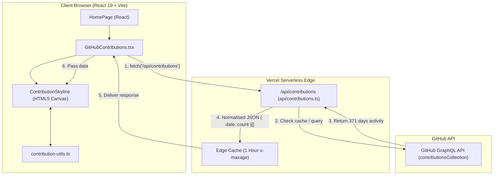

# Project & Developer Guide

Welcome to the comprehensive project guide for Lawand Soran's personal frontend developer portfolio. This guide provides an end-to-end reference for understanding how the codebase works, how its interactive features are built, how to develop locally, and what steps to take next to launch a complete, recruiter-ready portfolio.

---

## 1. Project Overview & Philosophy

### Core Concept: "Terminal Editorial"
The portfolio merges two complementary visual aesthetics:
1. **Developer Authenticity ("Terminal")**: Clean typography (JetBrains Mono), monospaced prompts (`~/intro`, `~/github`, `~/skills`), subtle window chrome, and an interactive 3D GitHub activity canvas.
2. **Editorial Clarity ("Editorial")**: Serifs for nuanced emphasis (Newsreader italic), robust reading measure (`68ch`), restrained spacing system, high-contrast dark surface palette (`#050505` to `#1a1a1a`), and zero gimmicks.

### Current Health & Benchmarks
- **Lighthouse Scores**: 100 Accessibility, 100 Best Practices, 100 SEO, 96+ Mobile Performance.
- **Cumulative Layout Shift (CLS)**: Exactly `0` across mobile and desktop viewports (achieved through eager route loading and `@base-ui/react` collapsible disclosures).
- **TypeScript & Lint**: Strict type checking (`tsc -b`) and zero ESLint errors.

---

## 2. Architecture & Data Flow

The portfolio is primarily a static Single Page Application (SPA) built with Vite, React 19, and Tailwind CSS v4, augmented with a Vercel Serverless Function to securely stream dynamic GitHub activity.

### System Data Flow Diagram



### Key Security Design
- The `GITHUB_TOKEN` secret **never reaches the browser bundle**.
- `api/contributions.ts` accesses `process.env.GITHUB_TOKEN` exclusively on the server.
- The token only requires the read-only `read:user` scope (never `repo` or write scopes).
- Responses are cached using `Cache-Control: public, s-maxage=3600, stale-while-revalidate=86400`, preventing GitHub API rate limiting.

---

## 3. The 3D Contribution Skyline Engine

The contribution chart (`src/contribution.tsx` & `src/contribution-utils.ts`) is a custom-engineered HTML5 Canvas visualization.

### How It Works

1. **Grid Generation (`buildGrid`)**:
   - Organizes the last 365+ days into 53 columns (weeks) and 7 rows (weekdays).
   - Determines the 95th percentile "busy" threshold so that a single outlier day (e.g. 50 commits) does not wash out normal activity days (1–5 commits) into flat slabs.
2. **Camera Projection (`camera`, `project`, `depthOf`)**:
   - **2D Mode**: Camera looks straight down from above (yaw $0^\circ$, elevation $90^\circ$). The bars render flat with no vertical height.
   - **3D Mode**: Camera swings to an isometric corner angle (yaw $45^\circ$, elevation $34^\circ$).
   - Coordinates in 3D $(x, y, z)$ project onto 2D canvas coordinates using trigonometric transformation matrices.
3. **The Wave Morph Animation (`riseAt`, cubic easing)**:
   - When toggling between 2D and 3D, bars don't pop up instantly. A wave sweeps diagonally from the oldest week to the newest week.
   - Cubic easing (`easeOutCubic`, `easeInOutCubic`) provides smooth momentum without third-party canvas animation libraries.
4. **Interactive 3D Orbiting**:
   - Pointer drag events dynamically update camera yaw ($8^\circ$ to $82^\circ$) and elevation ($18^\circ$ to $62^\circ$) within clamped bounds.
   - Double-clicking the canvas smoothly resets the camera back to the default isometric viewing angle.
5. **Theme Palettes (`PALETTES`)**:
   - `github`: Traditional GitHub activity greens (`#0e4429` to `#39d353`).
   - Alternative presets: `halloween` (warm amber/orange), `ocean` (cyan/blue), `ember` (fiery reds), `grape` (purple), `mono` (clean greyscale).

---

## 4. Local Development Workflows

### Standard Frontend Development
If you are working on UI, typography, layouts, or static pages:
```bash
npm install
npm run dev
```
*Note: In `npm run dev`, Vite runs locally on `http://localhost:5173`. The `/api/contributions` endpoint will show a simulated/retry state unless run through Vercel CLI.*

### Full-Stack Development with Live GitHub Data
To test the serverless function locally alongside the frontend:
```bash
# 1. Link your repo to your Vercel project (first time only)
npx vercel link

# 2. Pull environment variables into local .env.local
npx vercel env pull .env.local

# 3. Start local development with serverless functions enabled
npx vercel dev
```

### Build & Verification Commands
Always verify these before committing:
```bash
# Type check and production build
npm run build

# Run ESLint across entire codebase
npm run lint

# Preview the built production output
npm run preview
```

---

## 5. How-To Guides

### Guide 1: Adding Real Projects to Your Portfolio

Currently, `src/pages/WorkIndexPage.tsx` displays an honest placeholder state. When you are ready to add real projects:

#### Step 1: Define Your Project Data
Create a dedicated file, for example `src/data/projects.ts`:
```ts
export interface Project {
  id: string;
  title: string;
  tagline: string;
  description: string;
  technologies: string[];
  liveUrl?: string;
  githubUrl?: string;
  featured?: boolean;
}

export const projects: Project[] = [
  {
    id: 'project-one',
    title: 'Project Title Here',
    tagline: 'A responsive web application solving X problem.',
    description: 'Detailed description of the architectural choices, challenges overcome, and outcomes.',
    technologies: ['React', 'TypeScript', 'Tailwind CSS', 'Vite'],
    liveUrl: 'https://demo.example.com',
    githubUrl: 'https://github.com/lawand12-dev/project-one',
    featured: true,
  },
];
```

#### Step 2: Render Projects in `src/pages/WorkIndexPage.tsx`
Replace the empty state container in `WorkIndexPage.tsx` with a grid mapping over `projects`:
- Render project cards using the design system classes (`bg-surface`, `border-line`, `p-6`).
- Provide direct action links to the live deployment and GitHub repository.

#### Step 3: Highlight on `src/pages/HomePage.tsx`
Filter `projects.filter(p => p.featured)` and display the top 1 or 2 projects directly in the home page `~/work` section.

---

### Guide 2: Adding Your Resume

Recruiters frequently look for a quick one-click resume download or view.

#### Step 1: Place Your PDF
Save your compiled resume PDF into the public root:
```
public/Lawand_Soran_Resume.pdf
```
*Files in `public/` are served at the root URL (e.g. `https://your-portfolio.com/Lawand_Soran_Resume.pdf`).*

#### Step 2: Add Navigation Link
In `src/components/layout/NavBar.tsx`, add a link to the navigation list:
```tsx
<a 
  href="/Lawand_Soran_Resume.pdf" 
  target="_blank" 
  rel="noreferrer"
  className="portfolio-nav-link"
>
  Resume
</a>
```

#### Step 3: Add Download Action to About or Hero
In `src/pages/AboutPage.tsx` or `src/pages/HomePage.tsx`, add an action button:
```tsx
<a
  href="/Lawand_Soran_Resume.pdf"
  target="_blank"
  rel="noreferrer"
  className="portfolio-action portfolio-action--primary"
>
  Download Resume (PDF)
</a>
```

---

### Guide 3: Configuring Production Deployment on Vercel

1. **Connect Repository**: Import `Personal-portfolio` into Vercel via the Vercel Dashboard.
2. **Add Environment Variable**:
   - Name: `GITHUB_TOKEN`
   - Value: Personal Access Token (classic) with `read:user` permission generated from GitHub (`Settings -> Developer Settings -> Personal access tokens -> Tokens (classic)`).
   - Environments: Production, Preview, Development.
3. **Deploy**: Trigger a deployment. Vercel automatically detects the Vite build output (`dist/`) and compiles `api/contributions.ts` into a serverless endpoint.
4. **Custom Domain**: Connect your domain (e.g. `lawandsoran.dev` or similar) in Vercel Project Settings -> Domains.

---

### Guide 4: Setting Up Automated Tests with Vitest

Testing tools (`vitest`, `jsdom`, `@testing-library/react`) are already installed.

#### Step 1: Add Test Script to `package.json`
```json
"scripts": {
  "test": "vitest run",
  "test:watch": "vitest"
}
```

#### Step 2: Create a Unit Test
Create `src/contribution-utils.test.ts` to verify the mathematical and formatting utilities:
```ts
import { describe, it, expect } from 'vitest';
import { levelOf, barHeight, buildGrid } from './contribution-utils';

describe('contribution-utils', () => {
  it('correctly maps activity counts to levels 0-4', () => {
    expect(levelOf(0, 10)).toBe(0);
    expect(levelOf(2, 10)).toBe(1);
    expect(levelOf(10, 10)).toBe(4);
    expect(levelOf(15, 10)).toBe(4);
  });

  it('calculates proper 3D bar height', () => {
    expect(barHeight(0, 10)).toBe(0.2);
    expect(barHeight(10, 10)).toBeGreaterThan(7.0);
  });
});
```

Run tests with `npm test`.

---

## 6. Actionable Next Steps (Your Launch Roadmap)

Here is your prioritized, step-by-step checklist to take this portfolio from its current state to a live, recruiter-ready launch:

```
[ ] STEP 1: Add at Least Two Real Projects (HIGHEST PRIORITY)
    ├── Select 2 polished frontend projects outside this repo.
    ├── Ensure both have public GitHub repositories with informative READMEs.
    ├── Ensure both have working live deployments (e.g. on Vercel/Netlify).
    ├── Create project records and populate `src/pages/WorkIndexPage.tsx`.
    └── Feature the best project on `src/pages/HomePage.tsx`.

[ ] STEP 2: Add Resume PDF & Links
    ├── Export an up-to-date single-page PDF resume.
    ├── Place it in `public/Lawand_Soran_Resume.pdf`.
    └── Wire download/view links into `NavBar.tsx` and `AboutPage.tsx`.

[ ] STEP 3: Deploy to Vercel with GITHUB_TOKEN Secret
    ├── Generate GitHub Classic Token with `read:user` scope.
    ├── Add `GITHUB_TOKEN` in Vercel project environment settings.
    ├── Deploy and verify that live contributions render on your production URL.
    └── [x] Connected custom domain (`lawandsoran.site`).

[ ] STEP 4: Configure Vitest Automated Testing
    ├── Add `"test": "vitest run"` to `package.json`.
    ├── Add unit tests for `contribution-utils.ts` and UI smoke tests.
    └── Ensure `npm test && npm run build && npm run lint` all pass in CI.

[ ] STEP 5: Final Launch Polish
    ├── [x] Favicons and web manifest configured in `public/` (SVG, ICO, PNGs, and `site.webmanifest`).
    ├── [x] Sitemap (`sitemap.xml`) and `robots.txt` generated for `lawandsoran.site`.
    ├── [x] Canonical URL and Open Graph metadata configured for `lawandsoran.site`.
    └── Perform a final mobile and keyboard accessibility pass on physical devices.
```

